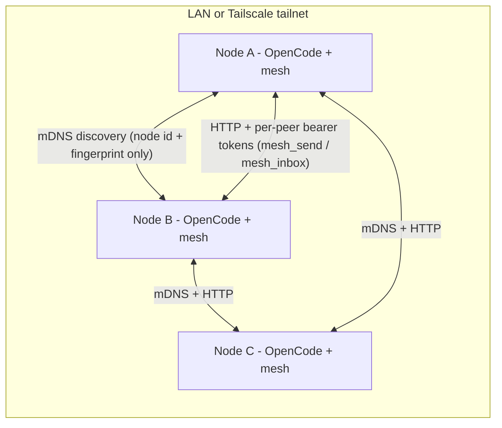
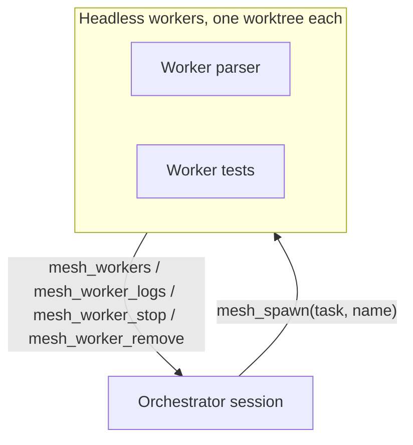
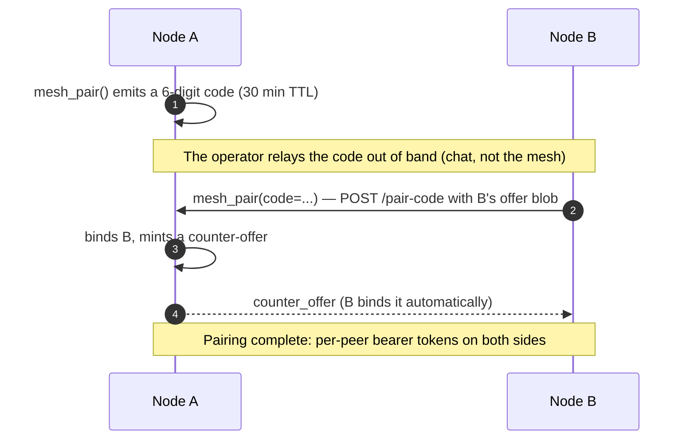

# opencode-mesh

[](https://github.com/log0u7/opencode-mesh/actions/workflows/ci.yml)
[](LICENSE)
[](https://www.typescriptlang.org)
[](https://www.npmjs.com/package/@log0u7/opencode-mesh)
[](https://www.npmjs.com/package/@log0u7/opencode-mesh)

Coordination for [OpenCode](https://opencode.ai): multiple sessions working together on one machine, and a peer pool across a LAN or a Tailscale tailnet.

Each node advertises itself over mDNS, pairs with explicit operator approval (per-peer bearer tokens, deny by default), then sessions can exchange messages (`mesh_send` / `mesh_inbox`) and coordinate on shared work (`mesh_lock` / `mesh_unlock`). Tailscale IPs are picked up automatically when `tailscale status` works, for cross-subnet pools.

`mesh_lock` is **local to your machine**: it is enforced between OpenCode sessions sharing this host's data directory (`~/.local/share/opencode-mesh/`). Locks are not part of the wire protocol, so a peer on another node does not see or respect them. Remote nodes coordinate through messages (`mesh_send`), not locks.

## Why

One OpenCode instance is one brain. When a task outgrows a single session, or you want to parallelise across machines, sessions need to talk to each other, claim files without stepping on each other, and workers you can spawn and reap. opencode-mesh adds that layer:

- **Same machine:** sessions coordinate through a local registry - messages (`mesh_send` / `mesh_inbox`) and exclusive file claims (`mesh_lock`).
- **Across the room:** nodes advertise over mDNS and pair with explicit operator approval (per-peer bearer tokens, deny by default). Tailscale IPs are picked up automatically for cross-subnet pools.
- **Headless workers:** `mesh_spawn` starts an isolated OpenCode worktree per worker, tracks its lifecycle, captures its logs, and cleans up on dispose.



## Highlights

- **Spawn headless workers in one call.** `mesh_spawn(task, name)` starts an isolated OpenCode worktree per worker; `mesh_workers`, `mesh_worker_logs`, `mesh_worker_stop` and `mesh_worker_remove` track and reap them. A pool of N workers costs N worktrees, not N mesh nodes.
- **Deny by default.** Every endpoint requires a per-peer bearer token except the rate-limited pairing bootstrap; pairing codes and offers expire after 30 minutes; pairing is one `mesh_pair` call per side; every mail carries an Ed25519 proof, so a leaked offer or code alone cannot install or rotate a live credential.
- **File claims between sessions.** `mesh_lock` gives exclusive claims on paths, enforced between sessions on the same machine, so two agents never edit the same file.
- **Deliberately simple wire protocol.** mDNS for discovery, bearer tokens for auth, four HTTP routes (`/mail`, `/status`, `/pools`, `/pair-code`), plain HTTP over loopback and trusted networks.

## Install

Register the plugin in `opencode.json` (project or global `~/.config/opencode/opencode.json`):

```json
{
  "plugin": ["@log0u7/opencode-mesh"]
}
```

Restart OpenCode. The package is installed automatically at startup into opencode's plugin cache (`~/.cache/opencode/packages/`); no global npm/pnpm/mise install is needed (opencode does not consult global installs for plugins). Pin a version if you want upgrades to be explicit:

```json
{
  "plugin": ["@log0u7/opencode-mesh@0.5.1"]
}
```

### Configuration

All options are optional; see [docs/CONFIGURATION.md](docs/CONFIGURATION.md) for the reference.

On OpenCode 1.x hosts, options travel in a package-and-options tuple:

```json
{
  "plugin": [["@log0u7/opencode-mesh", { "port": 4399, "bind": "loopback", "advertise": true }]]
}
```

On 2.x hosts the key is `plugins` and each entry is an object:

```json
{
  "plugins": [
    { "package": "@log0u7/opencode-mesh", "options": { "port": 4399, "bind": "lan" } }
  ]
}
```

Node identity and mailbox live under `~/.local/share/opencode-mesh/` (honors `XDG_DATA_HOME`), created with restrictive permissions.

Workers spawned with `mesh_spawn` run with `OPENCODE_MESH_CHILD=1`: they skip the mesh server, mDNS and all mesh tools, so a pool of N workers costs N worktrees, not N mesh nodes.

Note (npm 12): the package ships no lifecycle install scripts and needs no `allowScripts` / allowlist on install (its runtime dependency `bonjour-service` has none either).

## Usage

Same machine: start two OpenCode instances in the same repository.

```
mesh_register(name="purser", role="manager")   # claim a named mailbox for this session
mesh_send(to="quartermaster", subject="r8 go", body="...")   # targeted mail (this machine)
mesh_send(to="team:quartermaster", subject="status", body="...")   # pool broadcast
mesh_inbox()                       # only YOUR mailbox (plus legacy global mail), ack
mesh_wait(id="...", timeout=120)   # block until a reply_to lands, then return it
mesh_join(pool="team:quartermaster") / mesh_leave(pool="...") / mesh_pools()
mesh_lock(path="src/api.ts", ttl=300)   # claim a file before editing (this machine only)
mesh_unlock(path="src/api.ts")
```

### Pairing across machines (code)

```
mesh_pair()                                # host A: emit a 6-digit code, valid 30 min
mesh_pair(code="482913")                   # host B: same LAN, mDNS finds the address
mesh_pair(code="482913", address="192.168.1.10:4399")   # host B: cross-subnet
```

One call per side, both paired: the `/pair-code` exchange on host A binds host
B and returns a counter-offer that B binds automatically. The 6-digit code is
a capability, not a secret — trust stays on the pinned Ed25519 proof
([PROTOCOL.md](docs/PROTOCOL.md)). For agents and files,
`mesh_pair(offer="MESH1-...")` completes a whole offer blob in one string;
older mesh versions still accept the legacy `node_id` / `token` completion.

### Mailboxes and pools (multi-session routing)

All sessions on one machine used to share a single mailbox, so every session
draining the inbox ate everyone's messages. Mailboxes fix the routing:

- `mesh_register(name, role?)` binds this session to a named mailbox. One box
  per session; re-registering the same name from another session is a handoff.
  The box is stamped with an instance binding key (project id + directory): at
  every session start the TUI re-binds stamped boxes to the live session, so a
  restart or a replacement session picks its mailboxes back up with no
  configuration and no re-registration. A static `mailbox` / `mailboxRole`
  plugin option is available for permanent agents (see
  [CONFIGURATION.md](docs/CONFIGURATION.md)); on a name collision the last
  act wins.
- `mesh_send(to=...)` routes locally by mailbox name, or broadcasts with
  `team:<pool>` (members of a pool) or `all` (every registered box except the
  sender). `peer=...` still sends to a remote node; `to` is honored on the
  receiving node when its protocol supports it, otherwise the mail falls back
  to that node's global inbox.
- `mesh_inbox` reads only your box (plus legacy global mail), ack per message.
- Pools are dynamic and persisted server-side: `mesh_join` / `mesh_leave`, and
  the membership survives session restarts (a replacement session
  re-registering the same name finds its pools intact).
- Pools federate across paired hosts (0.10.0): a `team:*` broadcast reaches
  members on paired hosts (fanout with anti-loop `via[]` and `origin_id`
  dedup); each host keeps its own boxes and wake. See
  [ORGANIZATION.md](docs/ORGANIZATION.md), Model 5.
- `mesh_wait(id, timeout)` completes a request/response within one turn: it
  blocks the agent turn until a message with `reply_to: id` arrives.
- Presence: every tool interaction refreshes the mailbox `last_seen`;
  `mesh_status` lists mailboxes with role, pools and age.
- Wake (OpenCode 2.x): a plugin-side loop watches your mailbox and injects a
  prompt into the session when unread mail arrives, so an idle agent reacts
  without a human relaying the message. Disable with `wake: false` in the
  plugin options.
- Retention: messages older than 7 days are swept at server boot.

Multi-team wiring (flat teams, a `tower` orchestrator, a manager hierarchy,
ad-hoc squads) is documented in [docs/ORGANIZATION.md](docs/ORGANIZATION.md).

### Tools

| Tool | Args | Description |
|---|---|---|
| `mesh_status` | | Local session registry, named mailboxes (role, pools, presence), paired peers, active locks. |
| `mesh_register` | `name`, `role?` | Bind this session to a named mailbox (one box per session, re-register = handoff). |
| `mesh_pair` | `code?`, `address?`, `offer?`, `node_id?`, `token?`, `pk?` | No args: emit a 6-digit pairing code (30 min). `code=`: complete pairing — LAN autodiscovers the address, cross-subnet adds `address=`; both sides end up paired. `offer=`: complete a `MESH1-` blob. Legacy `node_id`/`token` accepted. |
| `mesh_send` | `peer?`, `to?`, `subject`, `body`, `reply_to?` | Deliver mail: `to` a mailbox / `team:<pool>` / `all` locally, and/or `peer` on another node. |
| `mesh_inbox` | `ack?` | Fetch unread messages addressed to this session's mailbox; ack marks them read. |
| `mesh_wait` | `id`, `timeout?` | Block until a reply (`reply_to`) to message `id` arrives, return it. |
| `mesh_join` / `mesh_leave` | `pool` | Add / remove this mailbox from a broadcast pool. |
| `mesh_pools` | | List pools with their member mailboxes. |
| `mesh_lock` | `path`, `ttl?` | Exclusive claim on a file or path, enforced only between sessions on this machine (default ttl 600s). Not visible to remote peers. |
| `mesh_unlock` | `path` | Release a claim. |

### Orchestrator

Spawn headless workers in isolated opencode worktrees (native worktree API), track them, and clean up:



```
mesh_spawn(task="implement the parser", name="parser")     # -> worker_id, worktree, branch
mesh_workers()                                             # lifecycle states, session ids
mesh_worker_logs(worker_id="...", tail=50)                 # captured output
mesh_worker_stop(worker_id="...")                          # SIGTERM a running worker
mesh_worker_remove(worker_id="...", force=true)            # worktree + registry row cleanup
```

Workers run `opencode run --dir <worktree> --format json` headless with `--auto` permissions by default (`auto=false` to require approvals). model/agent are optional args (defaults: your local config). `dispose` SIGTERMs every live worker so stopping opencode never leaves orphan processes.

### TUI

The plugin ships a TUI part (auto-loaded by OpenCode): a toast on load, a `/mesh` slash command, and a sidebar slot. Slash commands and the mesh tools remain the primary interface.

### Security model

- The HTTP mesh server binds to `127.0.0.1` by default. Set `"bind": "lan"` in the plugin options to listen on all interfaces for a LAN pool.
- Every endpoint requires a per-peer bearer token except the pairing bootstrap; nothing else is open by default.
- Pairing codes and offers expire after 30 minutes. The 6-digit code is a capability naming a pending offer, not a secret; `POST /pair-code` is the only unauthenticated route and is rate-limited (5 attempts per 5 minutes per source). On the mail path a pending token alone grants nothing: the claimed node must already be known to this host. Pairing is one `mesh_pair` call per side, so a leaked offer or code alone cannot install a permanent peer.
- Peer addresses always carry the advertised port; a portless address is refused instead of being completed with the local port.
- mDNS TXT records carry node id + fingerprint only, never secrets.
- Tailnet addresses are surfaced by `mesh_status` when `tailscale` runs, for cross-subnet pools.
- Messages travel over plain HTTP: there is no TLS layer. Loopback and trusted networks only.

The code pairing handshake (one `mesh_pair` call per side; a leaked offer or code alone installs nothing):



## Development

Requires Node >= 22.5 (`mise install`) and pnpm (corepack).

```sh
pnpm install
pnpm verify            # biome + typecheck + vitest + Node smoke of dist/
pnpm typecheck:tests   # typecheck the test suite (also enforced in CI)
pnpm build:check       # tsc build + pack dry-run
pnpm smoke:dist        # build, then load dist/ under plain Node (no vitest shims)
```

See [CONTRIBUTING.md](CONTRIBUTING.md) for the workflow, and the [docs/](docs/) folder for
[configuration](docs/CONFIGURATION.md), [architecture](docs/ARCHITECTURE.md), and the
wire [protocol](docs/PROTOCOL.md).

## License

[Apache-2.0](LICENSE)
