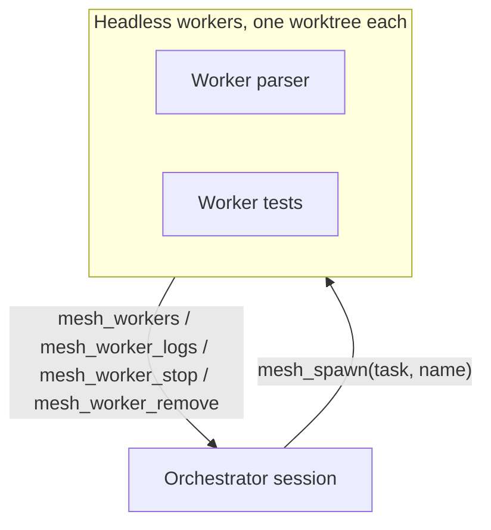
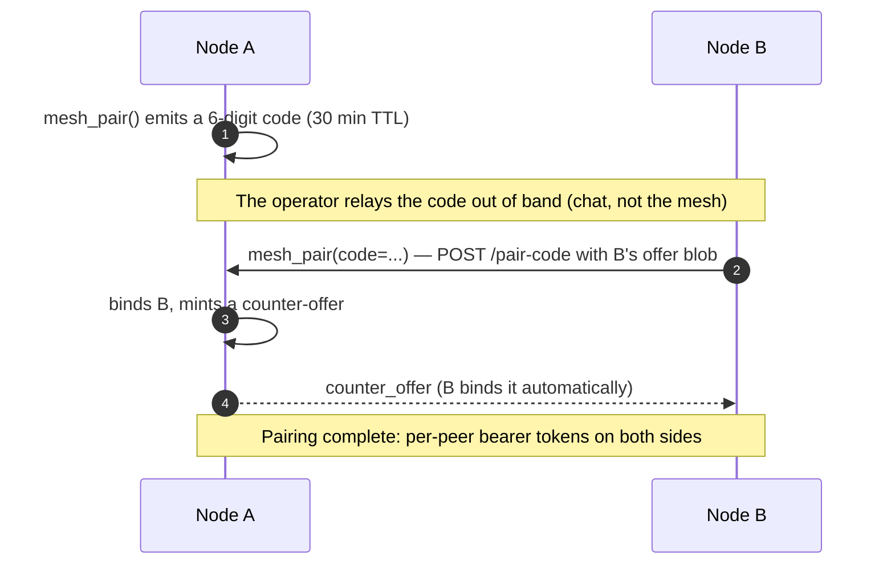

# opencode-mesh

[](https://github.com/log0u7/opencode-mesh/actions/workflows/ci.yml)
[](LICENSE)
[](https://www.typescriptlang.org)
[](https://www.npmjs.com/package/@log0u7/opencode-mesh)
[](https://www.npmjs.com/package/@log0u7/opencode-mesh)

opencode-mesh turns your machines into a fleet of (almost) autonomous agents: named mailboxes, team pools, automatic wake for idle sessions, an anchored shared memory, and a playbook of roles.

Sessions coordinate on one machine, and pools federate across a LAN or a VPN overlay (Tailscale, NetBird, ZeroTier — or static addresses for any tunnel): agents self-enroll at their first turn, wake on incoming work, and report `status:` to their team so an orchestrator can consolidate the state of the fleet. Security stays deny-by-default: pairing requires explicit operator approval with per-peer bearer tokens, and every mail carries an Ed25519 proof.

## Why

One OpenCode instance is one brain. When a task outgrows a single session, or you want to parallelise across machines, sessions need to talk to each other, claim files without stepping on each other, and workers you can spawn and reap. opencode-mesh adds that layer:

- **Same machine:** sessions coordinate through a local registry - messages (`mesh_send` / `mesh_inbox`) and exclusive file claims (`mesh_lock`).
- **Across the room:** nodes advertise over mDNS and pair with explicit operator approval (per-peer bearer tokens, deny by default). VPN overlay IPs are picked up automatically (Tailscale/Headscale, NetBird, ZeroTier) or declared statically for any tunnel (WireGuard, IPsec, SSL VPN).
- **Headless workers:** `mesh_spawn` starts an isolated OpenCode worktree per worker, tracks its lifecycle, captures its logs, and cleans up on dispose. With a `name`, the spawn is an enrolled fleet agent: it keeps the mesh tools and joins the fleet at its first turn (0.23.0). With `node=<paired peer>`, that agent is born on the peer (signed request, deny-by-default `acceptSpawn`, per-peer quota, ack DM — 0.24.0).


## Highlights

- **Named mailboxes, one per agent hat.** `mesh_register` binds a session to a named box; one session can wear several hats (one box per role); a restart re-binds the stamped boxes automatically, and re-registering a name from another session is a handoff (last binder wins).
- **Team pools with broadcast.** `team:*` pools carry announcements (`status:` / `decision:` / `alert:`), while discussion stays in DMs; `mesh_wait(id, timeout)` closes a request/response within one turn.
- **Wake idle agents.** A host-side loop watches mailboxes (5 s poll, 60 s per-mailbox cooldown) and injects a prompt into idle sessions, so an agent reacts to incoming work without a human relaying the message.
- **Multi-host federation.** Pair hosts with a 6-digit code; `team:*` broadcasts fan out to paired peers with anti-loop `via[]` and `origin_id` dedup, and each host keeps master of its own boxes and wake.
- **Anchored shared memory.** The fleet ledger lives in [opencode-memory](https://www.npmjs.com/package/@log0u7/opencode-memory) 0.11+: epics and tasks anchored to the code they touch self-stale when the code moves, and `supersedes` (0.12+) keeps one truth per decision instead of stacking duplicates.
- **Spawn headless workers in one call.** `mesh_spawn(task, name)` starts an isolated OpenCode worktree per worker; `mesh_workers`, `mesh_worker_logs`, `mesh_worker_stop` and `mesh_worker_remove` track and reap them. A pool of N workers costs N worktrees, not N mesh nodes. With `name`, `role` and `pools`, the spawn is born a fleet agent (enrolled spawn, 0.23.0).
- **Deny by default.** Every endpoint requires a per-peer bearer token except the rate-limited pairing bootstrap; pairing codes and offers expire after 30 minutes; every mail carries an Ed25519 proof, so a leaked offer or code alone cannot install or rotate a live credential.
- **File claims between sessions.** `mesh_lock` gives exclusive claims on paths, enforced between sessions on the same machine (not part of the wire protocol), so two agents never edit the same file.
- **Deliberately simple wire protocol.** mDNS for discovery, bearer tokens for auth, five HTTP routes (`/mail`, `/status`, `/metrics`, `/pools`, `/pair-code`), plain HTTP over loopback and trusted networks.
- **Host capabilities + Prometheus metrics.** `mesh_status` carries a `capa` snapshot (cpu cores + load, RAM, GPU VRAM when `nvidia-smi` answers, workers in flight, sessions mid-turn) and `GET /metrics` renders the same 60 s-cached gauges plus mail counters in Prometheus text format, ready for a VictoriaMetrics scrape.

## Fleet in 10 minutes

1. **Install the plugin on every host.** See [Install](#install) below, then restart OpenCode.
2. **Pair the hosts.** `mesh_pair()` on host A emits a 6-digit code (30 min); `mesh_pair(code="...")` on host B completes it. One call per side, both paired.
3. **Paste a role prompt.** Pick a role from the [playbook](docs/PLAYBOOK.md) (orchestrator, team lead, bridge, ops, worker pair) into each agent's instructions. Enrollment prompts execute only in build mode (plan mode plans, never runs) — check the mode before pasting.
4. **Let the agents self-enroll.** At their first turn they run `mesh_register` / `mesh_join` and confirm by DM to their lead; after a restart, TUI sessions re-bind their boxes automatically.
5. **Wake does the relaying.** Idle agents are prompted when mail lands in their box; leads post `status:` per team; discussions stay in DMs.
6. **The orchestrator consolidates.** It maintains the global TODO as opencode-memory entries anchored to the code they touch, and posts a daily digest per team.

Roles, enrollment lifecycle and rituals: [docs/PLAYBOOK.md](docs/PLAYBOOK.md). Multi-team wiring models: [docs/ORGANIZATION.md](docs/ORGANIZATION.md).

## Install

Register the plugin in `opencode.json` (project or global `~/.config/opencode/opencode.json`):

```json
{
  "plugin": ["@log0u7/opencode-mesh"]
}
```

Restart OpenCode. The package is installed automatically at startup into opencode's plugin cache (`~/.cache/opencode/packages/`); no global npm/pnpm/mise install is needed (opencode does not consult global installs for plugins). Pin a version if you want upgrades to be explicit:

```json
{
  "plugin": ["@log0u7/opencode-mesh@0.20.0"]
}
```

### Configuration

All options are optional; see [docs/CONFIGURATION.md](docs/CONFIGURATION.md) for the reference.

On OpenCode 1.x hosts, options travel in a package-and-options tuple:

```json
{
  "plugin": [["@log0u7/opencode-mesh", { "port": 4399, "bind": "loopback", "advertise": true }]]
}
```

On 2.x hosts the key is `plugins` and each entry is an object:

```json
{
  "plugins": [
    { "package": "@log0u7/opencode-mesh", "options": { "port": 4399, "bind": "lan" } }
  ]
}
```

Node identity and mailbox live under `~/.local/share/opencode-mesh/` (honors `XDG_DATA_HOME`), created with restrictive permissions.

Workers spawned with `mesh_spawn` run with `OPENCODE_MESH_CHILD=1`: they skip the mesh server, mDNS and all mesh tools, so a pool of N workers costs N worktrees, not N mesh nodes. Spawned WITH a `name`, a worker is instead an enrolled fleet agent (`OPENCODE_MESH_CHILD=enrolled`): it keeps the mesh tools, self-enrolls from its prompt header at its first turn and joins its pools; `spawnMax` (default 4) caps the running enrolled workers. Spawned with `node=<paired peer>` (0.24.0), the enrolled agent is born ON THAT PEER: the request is signed with this node's key and the peer — after the operator enabled `acceptSpawn` there — runs its own enrolled-spawn path, stamps the worker with the requesting peer (`spawnQuotaPeer`, default 2, per peer) and DMs back `spawned <name> on <hostname> (worker <id>)`. A distant worker lives on the peer's registry: the parent does not manage it remotely (v1) — the agent posts its own `status:` to the pools like any member, and reaping is the peer's job (`mesh_worker_stop` there).

Note (npm 12): the package ships no lifecycle install scripts and needs no `allowScripts` / allowlist on install (its runtime dependency `bonjour-service` has none either).

## Usage

Same machine: start two OpenCode instances in the same repository.

```
mesh_register(name="builder", role="worker")   # claim a named mailbox for this session
mesh_send(to="reviewer", subject="build done", body="...")   # targeted mail (this machine)
mesh_send(to="team:build", subject="status", body="...")   # pool broadcast (quiet)
mesh_send(to="team:build", subject="build done", body="...", wake=true)   # deliberate broadcast: wakes every member
mesh_inbox()                       # only YOUR mailbox (plus legacy global mail), ack
mesh_wait(id="...", timeout=120)   # block until a reply_to lands, then return it
mesh_join(pool="team:build") / mesh_leave(pool="...") / mesh_pools()
mesh_lock(path="src/api.ts", ttl=300)   # claim a file before editing (this machine only)
mesh_unlock(path="src/api.ts")
```

### Pairing across machines (code)

```
mesh_pair()                                # host A: emit a 6-digit code, valid 30 min
mesh_pair(code="482913")                   # host B: same LAN, mDNS finds the address
mesh_pair(code="482913", address="192.168.1.10:4399")   # host B: cross-subnet
```

One call per side, both paired: the `/pair-code` exchange on host A binds host
B and returns a counter-offer that B binds automatically. The 6-digit code is
a capability, not a secret — trust stays on the pinned Ed25519 proof
([PROTOCOL.md](docs/PROTOCOL.md)). For agents and files,
`mesh_pair(offer="MESH1-...")` completes a whole offer blob in one string;
older mesh versions still accept the legacy `node_id` / `token` completion.

### Overlay addresses (cross-subnet pools)

`mesh_status` publishes the overlay IPs **this machine** holds under
`tailnet_addresses` (field name kept from the tailscale-only era). Address
discovery is modular — one provider per overlay, each a function that renders
this machine's IPs (60 s cache, 2 s timeout, absent CLI = empty list, never an
error):

| Overlay | How the IPs are found |
|---|---|
| Tailscale (incl. Headscale) | native — `tailscale status --json` (`Self.TailscaleIPs`) |
| Netbird | native — `netbird status --json` (top-level `netbirdIp`) |
| ZeroTier | native — `zerotier-cli listnetworks` (assigned-IP column) |
| WireGuard / IPsec / any SSL VPN | static — declare them in the plugin options |

No CLI installed? The provider contributes nothing and costs nothing. Tunnels
without a CLI (WireGuard, IPsec, any VPN you manage yourself) declare their
addresses statically:

```json
{ "package": "@log0u7/opencode-mesh", "options": {
    "addresses": ["10.8.0.2", "10.99.0.7"],
    "providers": { "netbird": false }
} }
```

`addresses` are rendered as-is alongside the provider-discovered IPs;
`providers` toggles a provider off by name (default: all enabled). The shape
of a provider is one function — `cachedProvider(name, listFn, ttlMs, timeout)`
in `src/lib/providers.ts` — and one entry in `ADDRESS_PROVIDERS`: **add yours
by PR**, there is no runtime plugin system.

### Mailboxes and pools (multi-session routing)

All sessions on one machine used to share a single mailbox, so every session
draining the inbox ate everyone's messages. Mailboxes fix the routing:

- `mesh_register(name, role?)` binds this session to a named mailbox. One box
  per session; re-registering the same name from another session is a handoff.
  The box is stamped with an instance binding key (project id + directory): at
  every session start the TUI re-binds stamped boxes to the live session, so a
  restart or a replacement session picks its mailboxes back up with no
  configuration and no re-registration. A static `mailbox` / `mailboxRole`
  plugin option is available for permanent agents (see
  [CONFIGURATION.md](docs/CONFIGURATION.md)); on a name collision the last
  act wins.
- `mesh_send(to=...)` routes locally by mailbox name, or broadcasts with
  `team:<pool>` (members of a pool) or `all` (every registered box except the
  sender). `peer=...` still sends to a remote node; `to` is honored on the
  receiving node when its protocol supports it, otherwise the mail falls back
  to that node's global inbox.
- `mesh_inbox` reads only your box (plus legacy global mail), ack per message.
- Pools are dynamic and persisted server-side: `mesh_join` / `mesh_leave`, and
  the membership survives session restarts (a replacement session
  re-registering the same name finds its pools intact).
- Pools federate across paired hosts (0.10.0): a `team:*` broadcast reaches
  members on paired hosts (fanout with anti-loop `via[]` and `origin_id`
  dedup); each host keeps its own boxes and wake. See
  [ORGANIZATION.md](docs/ORGANIZATION.md), Model 5.
- `mesh_wait(id, timeout)` completes a request/response within one turn: it
  blocks the agent turn until a message with `reply_to: id` arrives.
- Presence: every tool interaction refreshes the mailbox `last_seen`;
  `mesh_status` lists mailboxes with role, pools and age.
- Wake (OpenCode 2.x): a plugin-side loop watches your mailbox and injects a
  prompt into the session when unread mail arrives, so an idle agent reacts
  without a human relaying the message. Disable with `wake: false` in the
  plugin options.
- Retention: messages older than 7 days are swept at server boot.

Multi-team wiring (flat teams, a `tower` orchestrator, a manager hierarchy,
ad-hoc squads) is documented in [docs/ORGANIZATION.md](docs/ORGANIZATION.md),
and the role prompts plus the enrollment lifecycle in
[docs/PLAYBOOK.md](docs/PLAYBOOK.md).

### Tools

| Tool | Args | Description |
|---|---|---|
| `mesh_status` | | Local session registry, named mailboxes (role, pools, presence), paired peers, active locks. |
| `mesh_register` | `name`, `role?`, `primary?` | Bind this session to a named mailbox (one box per session, re-register = handoff). `primary` declares the primary group (pool id, must exist) and auto-joins it if the box has not joined it yet. |
| `mesh_pair` | `code?`, `address?`, `offer?`, `node_id?`, `token?`, `pk?` | No args: emit a 6-digit pairing code (30 min). `code=`: complete pairing — LAN autodiscovers the address, cross-subnet adds `address=`; both sides end up paired. `offer=`: complete a `MESH1-` blob. Legacy `node_id`/`token` accepted. |
| `mesh_send` | `peer?`, `to?`, `subject`, `body`, `reply_to?` | Deliver mail: `to` a mailbox / `team:<pool>` / `all` locally, and/or `peer` on another node. |
| `mesh_inbox` | `ack?` | Fetch unread messages addressed to this session's mailbox; ack marks them read. |
| `mesh_wait` | `id`, `timeout?` | Block until a reply (`reply_to`) to message `id` arrives, return it. |
| `mesh_journal` | `since?`, `mailbox?`, `limit?`, `pool?` | Read-only journal of the traffic this machine saw: who, what, to whom, when (metadata only — bodies stay in `mesh_inbox`). |
| `mesh_join` / `mesh_leave` | `pool` | Add / remove this mailbox from a broadcast pool. |
| `mesh_pools` | | List pools with their member mailboxes. |
| `mesh_lock` | `path`, `ttl?` | Exclusive claim on a file or path, enforced only between sessions on this machine (default ttl 600s). Not visible to remote peers. |
| `mesh_unlock` | `path` | Release a claim. |

### Orchestrator

Spawn headless workers in isolated opencode worktrees (native worktree API), track them, and clean up:



```
mesh_spawn(task="implement the parser", name="parser")     # -> worker_id, worktree, branch
mesh_spawn(task="review the diff", name="reviewer", role="reviewer", pools=["team:x"])
                                                           # -> enrolled fleet agent: keeps the
                                                           #    mesh tools, self-enrolls at first turn
mesh_spawn(task="triage the queue", name="triage", pools=["team:x"], node="ricinus-communis")
                                                           # -> distant spawn (0.24.0): the enrolled agent is
                                                           #    born on that paired peer (signed request; the
                                                           #    peer must run acceptSpawn=true); it DMs back
                                                           #    "spawned <name> on <hostname> (worker <id>)"
mesh_workers()                                             # lifecycle states, session ids
mesh_worker_logs(worker_id="...", tail=50)                 # captured output
mesh_worker_stop(worker_id="...")                          # SIGTERM a running worker
mesh_worker_remove(worker_id="...", force=true)            # worktree + registry row cleanup
```

Workers run `opencode run --dir <worktree> --format json` headless with `--auto` permissions by default (`auto=false` to require approvals). model/agent are optional args (defaults: your local config). `dispose` SIGTERMs every live worker so stopping opencode never leaves orphan processes.

### TUI

The plugin ships a TUI part (auto-loaded by OpenCode): a toast on load, a `/mesh` slash command, and a sidebar slot. Slash commands and the mesh tools remain the primary interface. The sidebar shows this tab's view of the fleet: legend at [TUI panel](#tui-panel).

### Security model

- The HTTP mesh server binds to `127.0.0.1` by default. Set `"bind": "lan"` in the plugin options to listen on all interfaces for a LAN pool.
- Every endpoint requires a per-peer bearer token except the pairing bootstrap; nothing else is open by default. `/metrics` uses the same bearer token — Prometheus sends the `Authorization` header natively:

  ```yaml
  scrape_configs:
    - job_name: opencode-mesh
      metrics_path: /metrics
      scheme: https
      authorization:
        credentials: <peer token>
      static_configs:
        - targets: ["127.0.0.1:4399"]
  ```
- Pairing codes and offers expire after 30 minutes. The 6-digit code is a capability naming a pending offer, not a secret; `POST /pair-code` is the only unauthenticated route and is rate-limited (5 attempts per 5 minutes per source). On the mail path a pending token alone grants nothing: the claimed node must already be known to this host. Pairing is one `mesh_pair` call per side, so a leaked offer or code alone cannot install a permanent peer.
- Peer addresses always carry the advertised port; a portless address is refused instead of being completed with the local port.
- mDNS TXT records carry node id + fingerprint only, never secrets.
- Advertised overlay addresses (tailscale, netbird, zerotier, plus your static
  tunnel IPs) are surfaced by `mesh_status` (`tailnet_addresses`), for cross-subnet pools.
- All mesh traffic travels over TLS (0.11+): each node presents a self-signed certificate derived from its Ed25519 identity key — the very key peers already pin — so the certificate adds zero new trust. Clients pin the peer's certificate key (its SPKI) exactly like the pairing key: a swapped certificate is rejected during the handshake, before any mail body is read. The only unpinned moment is the first `POST /pair-code` over TLS (TOFU: the presented key must then equal the key the counter-offer attests). Peers on 0.10.x cannot send to a 0.11+ node until both hosts upgrade.
- Escape hatch: set `"insecureHttp": true` to open an extra plain-HTTP listener on port+1 (for a legacy peer you cannot upgrade yet); `"tls": false` turns TLS off entirely. Both stay off by default.

The code pairing handshake (one `mesh_pair` call per side; a leaked offer or code alone installs nothing):



## TUI panel

The sidebar panel (OpenCode 2.x) shows this tab's view of the fleet and refreshes live; click its header to collapse it. Expanded:

```
▼ Mesh: quartermaster
  also purser
  ● 3 unread
  ≔ lead
  ≔ lead
  ≡  team:purser (2)
  ≡  team:infra (5)
  ⌂  7 agents · 6 pools · 3 hosts
  ⇄  ricinus-communis
  ⇄  gpu3080
```

| Line | Meaning |
|---|---|
| `▼ Mesh: <name>` | The identity of THIS tab: the first hat (the name only — no role here); the other hats follow as `also` lines. |
| `≔ <role>` | One line per hat that declares a role, after the unread line and before the pools. Truncated at the last word boundary that fits the panel width (default 32), never mid-word; the full role lives in `mesh_status`. |
| `● N unread` | Unread messages in your mailboxes, the ones the wake loop reacts to. Omitted at 0. |
| `≡ <pool> (N)` | A pool one of your hats belongs to; `N` = its member count. Sorted by your unread in them (descending, then alphabetical), capped at six rows before `≡ … +N more`. |
| `⌂ N agents · N pools · N hosts` | The fleet as seen by this host. |
| `⇄ <hostname>` | A paired host, one per line (TLS-pinned); capped at six rows before `⇄ … +N more`. |
| `▶ Mesh ● N unread` (mail pending) or `▶ Mesh · N agents · N pools · N hosts` (quiet) | Collapsed: the toggle plus either the attention state or the inventory — never both stacked. |

The glyphs are single-width Unicode characters (DejaVu renders them correctly); the `icons: false` plugin option swaps them for the text labels `pools`, `fleet` and `peers`, for terminals that draw them double-cell.

### Status reference

Every state and marker the panel can render, verified against the sidebar formatters in `src/rpc.ts`:

| Marker | Meaning |
|---|---|
| `▼ Mesh: <name>` | Expanded header, the clickable row: this tab's first hat, the name only. A session without a mailbox renders a bare `▼ Mesh`. |
| `also <name>` | Each extra hat of this tab, one line per mailbox in enrollment order. No role here: every hat's role renders on its own `≔` line. |
| `≔ <role>` | One line per hat that declares a role (multi-hat sessions get several, in enrollment order), placed after the unread line and before the pools. Truncated at the last word boundary that fits the panel width (default 32), never mid-word; the full role lives in `mesh_status`. |
| `● N unread` | Unread mail across your mailboxes, the counter the wake loop reacts to. Shown only when `N > 0`. |
| `no mailbox: mesh_register` | Expanded only: this session has no mailbox yet, enroll with `mesh_register`. |
| `≡ <pool> (N)` | A pool one of your hats belongs to; `N` = its member count. Sorted by your unread in them (descending, then alphabetical), capped at six rows before `≡ … +N more`. |
| `⌂ N agents · N pools · N hosts` | The fleet as seen by this host: `N agents` counts every mailbox registered on the node, `N pools` every pool it knows, `N hosts` = 1 + paired peers. |
| `⇄ <hostname>` | A paired host, one per line, capped at six rows before `⇄ … +N more`. Manual pairings (placeholder hostname `manual`) show the short node id instead. |
| `▶ Mesh ● N unread` | Collapsed, mail pending: the attention state alone; it replaces the inventory, never stacked with it. |
| `▶ Mesh · N agents · N pools · N hosts` | Collapsed, quiet (nothing unread): the same fleet inventory as the expanded `⌂` line. |
| `pools` / `fleet` / `peers` | With the `icons: false` option: the `≡`, `⌂` and `⇄` glyphs (and their `…` overflow marks) swap for these lowercase labels; `▼`, `●`, `≔` and `also` stay. |

The collapsed header carries either the attention state or the inventory, never both; the expanded panel lays out everything that applies.

## Development

Requires Node >= 22.5 (`mise install`) and pnpm (corepack).

```sh
pnpm install
pnpm verify            # biome + typecheck + vitest + Node smoke of dist/
pnpm typecheck:tests   # typecheck the test suite (also enforced in CI)
pnpm build:check       # tsc build + pack dry-run
pnpm smoke:dist        # build, then load dist/ under plain Node (no vitest shims)
```

See [CONTRIBUTING.md](CONTRIBUTING.md) for the workflow, and the [docs/](docs/) folder for
[configuration](docs/CONFIGURATION.md), [architecture](docs/ARCHITECTURE.md), the
[organization models](docs/ORGANIZATION.md), the fleet [playbook](docs/PLAYBOOK.md), and the
wire [protocol](docs/PROTOCOL.md).

## License

[Apache-2.0](LICENSE)
