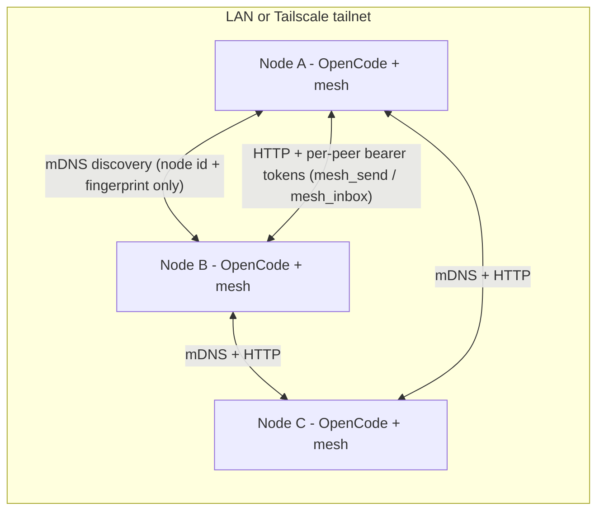
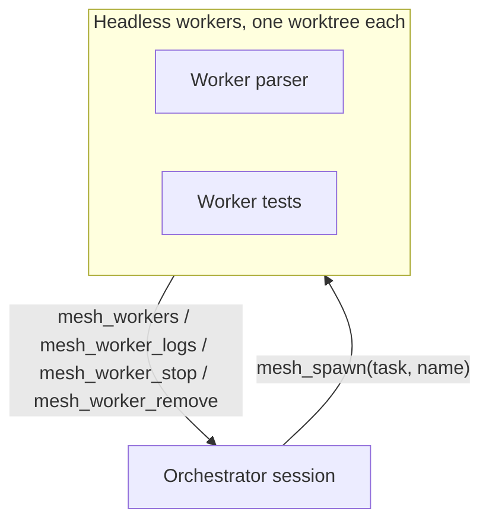
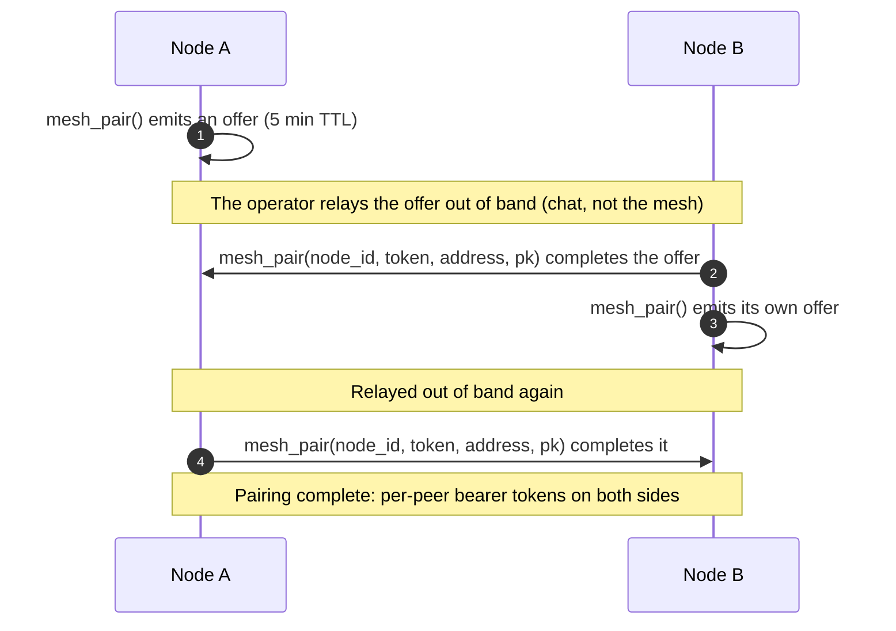

# opencode-mesh

[](https://github.com/log0u7/opencode-mesh/actions/workflows/ci.yml)
[](LICENSE)
[](https://www.typescriptlang.org)
[](https://www.npmjs.com/package/@log0u7/opencode-mesh)
[](https://www.npmjs.com/package/@log0u7/opencode-mesh)

Coordination for [OpenCode](https://opencode.ai): multiple sessions working together on one machine, and a peer pool across a LAN or a Tailscale tailnet.

Each node advertises itself over mDNS, pairs with explicit operator approval (per-peer bearer tokens, deny by default), then sessions can exchange messages (`mesh_send` / `mesh_inbox`) and coordinate on shared work (`mesh_lock` / `mesh_unlock`). Tailscale IPs are picked up automatically when `tailscale status` works, for cross-subnet pools.

`mesh_lock` is **local to your machine**: it is enforced between OpenCode sessions sharing this host's data directory (`~/.local/share/opencode-mesh/`). Locks are not part of the wire protocol, so a peer on another node does not see or respect them. Remote nodes coordinate through messages (`mesh_send`), not locks.

## Why

One OpenCode instance is one brain. When a task outgrows a single session, or you want to parallelise across machines, sessions need to talk to each other, claim files without stepping on each other, and workers you can spawn and reap. opencode-mesh adds that layer:

- **Same machine:** sessions coordinate through a local registry - messages (`mesh_send` / `mesh_inbox`) and exclusive file claims (`mesh_lock`).
- **Across the room:** nodes advertise over mDNS and pair with explicit operator approval (per-peer bearer tokens, deny by default). Tailscale IPs are picked up automatically for cross-subnet pools.
- **Headless workers:** `mesh_spawn` starts an isolated OpenCode worktree per worker, tracks its lifecycle, captures its logs, and cleans up on dispose.



## Highlights

- **Spawn headless workers in one call.** `mesh_spawn(task, name)` starts an isolated OpenCode worktree per worker; `mesh_workers`, `mesh_worker_logs`, `mesh_worker_stop` and `mesh_worker_remove` track and reap them. A pool of N workers costs N worktrees, not N mesh nodes.
- **Deny by default.** Every endpoint requires a per-peer bearer token; pairing offers expire after 5 minutes; both sides must run `mesh_pair`; every mail carries an Ed25519 proof, so a leaked offer cannot install or rotate a live credential.
- **File claims between sessions.** `mesh_lock` gives exclusive claims on paths, enforced between sessions on the same machine, so two agents never edit the same file.
- **Deliberately simple wire protocol.** mDNS for discovery, bearer tokens for auth, two HTTP routes (`/mail`, `/status`), plain HTTP over loopback and trusted networks.

## Install

Register the plugin in `opencode.json` (project or global `~/.config/opencode/opencode.json`):

```json
{
  "plugin": ["@log0u7/opencode-mesh"]
}
```

Restart OpenCode. The package is installed automatically at startup into opencode's plugin cache (`~/.cache/opencode/packages/`); no global npm/pnpm/mise install is needed (opencode does not consult global installs for plugins). Pin a version if you want upgrades to be explicit:

```json
{
  "plugin": ["@log0u7/opencode-mesh@0.5.1"]
}
```

### Configuration

All options are optional; see [docs/CONFIGURATION.md](docs/CONFIGURATION.md) for the reference.

On OpenCode 1.x hosts, options travel in a package-and-options tuple:

```json
{
  "plugin": [["@log0u7/opencode-mesh", { "port": 4399, "bind": "loopback", "advertise": true }]]
}
```

On 2.x hosts the key is `plugins` and each entry is an object:

```json
{
  "plugins": [
    { "package": "@log0u7/opencode-mesh", "options": { "port": 4399, "bind": "lan" } }
  ]
}
```

Node identity and mailbox live under `~/.local/share/opencode-mesh/` (honors `XDG_DATA_HOME`), created with restrictive permissions.

Workers spawned with `mesh_spawn` run with `OPENCODE_MESH_CHILD=1`: they skip the mesh server, mDNS and all mesh tools, so a pool of N workers costs N worktrees, not N mesh nodes.

Note (npm 12): the package ships no lifecycle install scripts and needs no `allowScripts` / allowlist on install (its runtime dependency `bonjour-service` has none either).

## Usage

Same machine: start two OpenCode instances in the same repository.

```
mesh_status()                      # local sessions + paired peers + active locks
mesh_pair()                        # emit a pairing offer (5 min) / complete the peer's offer
mesh_send(peer="laptop", subject="handoff", body="...")
mesh_inbox()                       # pull new messages, ack
mesh_lock(path="src/api.ts", ttl=300)   # claim a file before editing (this machine only)
mesh_unlock(path="src/api.ts")
```

### Tools

| Tool | Args | Description |
|---|---|---|
| `mesh_status` | | Local session registry, own address, paired peers, active locks. |
| `mesh_pair` | `node_id?`, `token?`, `address?` | No args: emit a pairing offer (5 min ttl). With args: complete the peer's offer. |
| `mesh_send` | `peer`, `subject`, `body` | Deliver a message to a peer's mailbox. |
| `mesh_inbox` | `ack?` | Fetch unread messages; ack marks them read. |
| `mesh_lock` | `path`, `ttl?` | Exclusive claim on a file or path, enforced only between sessions on this machine (default ttl 600s). Not visible to remote peers. |
| `mesh_unlock` | `path` | Release a claim. |

### Orchestrator

Spawn headless workers in isolated opencode worktrees (native worktree API), track them, and clean up:



```
mesh_spawn(task="implement the parser", name="parser")     # -> worker_id, worktree, branch
mesh_workers()                                             # lifecycle states, session ids
mesh_worker_logs(worker_id="...", tail=50)                 # captured output
mesh_worker_stop(worker_id="...")                          # SIGTERM a running worker
mesh_worker_remove(worker_id="...", force=true)            # worktree + registry row cleanup
```

Workers run `opencode run --dir <worktree> --format json` headless with `--auto` permissions by default (`auto=false` to require approvals). model/agent are optional args (defaults: your local config). `dispose` SIGTERMs every live worker so stopping opencode never leaves orphan processes.

### TUI

The plugin ships a TUI part (auto-loaded by OpenCode): a toast on load, a `/mesh` slash command, and a sidebar slot. Slash commands and the mesh tools remain the primary interface.

### Security model

- The HTTP mesh server binds to `127.0.0.1` by default. Set `"bind": "lan"` in the plugin options to listen on all interfaces for a LAN pool.
- Every endpoint requires a per-peer bearer token; nothing is open by default.
- Pairing offers expire after 5 minutes. A pending token alone grants nothing: the claimed node must already be known to this host (discovered over mDNS, or paired out of band with `mesh_pair`). Both sides run `mesh_pair` to complete a pairing, so a leaked offer cannot install a permanent peer on its own.
- Peer addresses always carry the advertised port; a portless address is refused instead of being completed with the local port.
- mDNS TXT records carry node id + fingerprint only, never secrets.
- Tailnet addresses are surfaced by `mesh_status` when `tailscale` runs, for cross-subnet pools.
- Messages travel over plain HTTP: there is no TLS layer. Loopback and trusted networks only.

The pairing handshake (both sides must run `mesh_pair`; a leaked offer alone installs nothing):



## Development

Requires Node >= 22.5 (`mise install`) and pnpm (corepack).

```sh
pnpm install
pnpm verify            # biome + typecheck + vitest + Node smoke of dist/
pnpm typecheck:tests   # typecheck the test suite (also enforced in CI)
pnpm build:check       # tsc build + pack dry-run
pnpm smoke:dist        # build, then load dist/ under plain Node (no vitest shims)
```

See [CONTRIBUTING.md](CONTRIBUTING.md) for the workflow, and the [docs/](docs/) folder for
[configuration](docs/CONFIGURATION.md), [architecture](docs/ARCHITECTURE.md), and the
wire [protocol](docs/PROTOCOL.md).

## License

[Apache-2.0](LICENSE)
