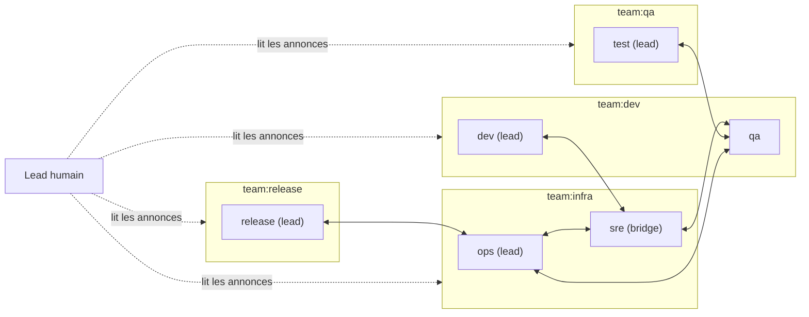
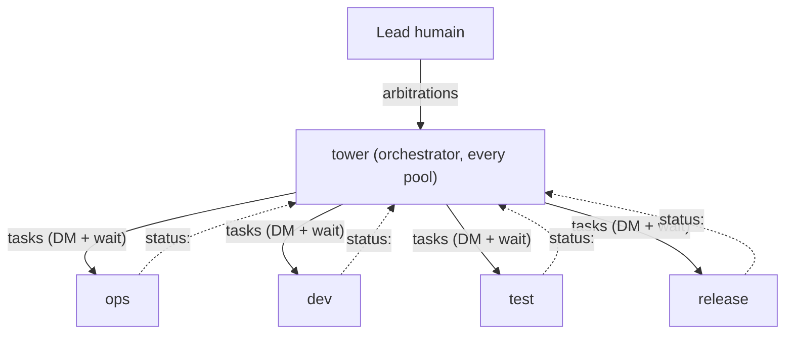
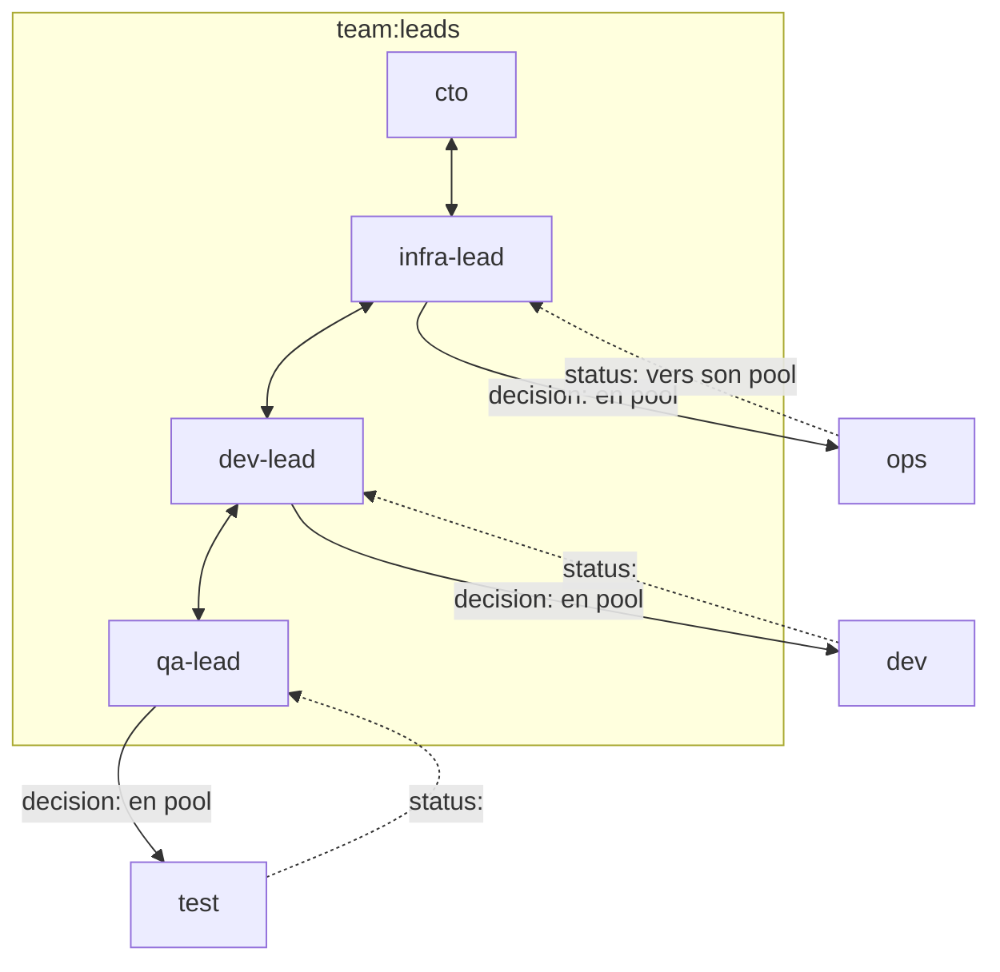
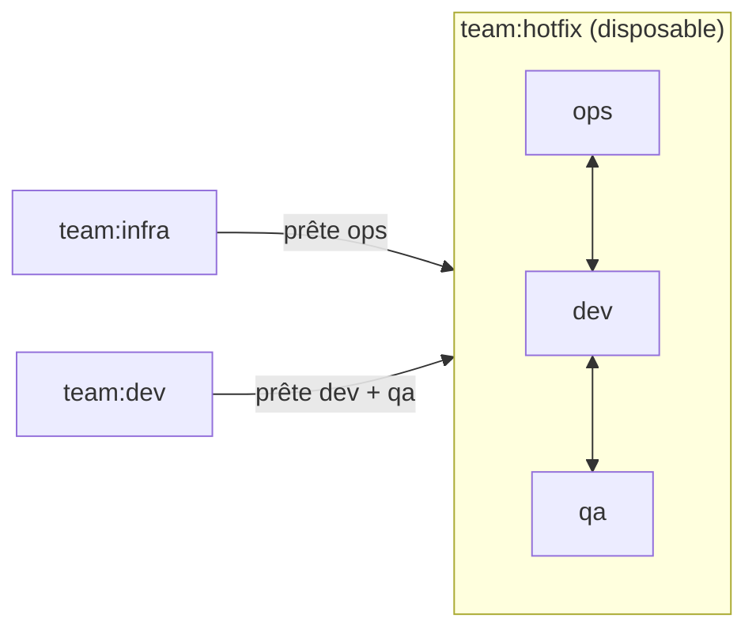
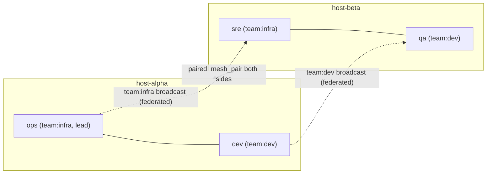

# Organization patterns

How to wire multi-team agent organizations on the mesh. Five reference models,
from flat to hierarchical to pools spread across hosts — all built from the
same primitives: named
mailboxes (`mesh_register`), pools (`mesh_join` / `mesh_leave` / `team:*`
broadcasts), direct messages (`mesh_send` to a mailbox), synchronous
request/response (`mesh_ask`/`mesh_reply`, server-side correlation), presence (`●` fresh, `○`
warm) and the wake loop for idle sessions.

Two invariants hold in every model:

- **Pools are announcements.** Subjects: `status:` (task done), `decision:`
  (lead arbitration), `alert:`. No discussion in pools — it would flood every
  member's inbox and the wake loop would prompt them all.
- **Discussion is direct.** Questions, brainstorms and tasks are DMs between
  mailboxes; the sender can `mesh_ask` for a
  synchronous answer within one turn.

Pools federate across paired hosts since 0.10.0 (Model 5), but each host
remains master of its mailboxes and its wake loop.

## Model 1 — Flat teams, no central coordination

One pool per team, one lead per pool, the human lead reads the pools. Bridges
are agents that belong to several pools: they carry announcements across teams
without manual relay.

```
Lead humain
 ├─ team:infra    ops (lead), sre (bridge)
 ├─ team:dev      dev (lead), qa (pair), sre
 ├─ team:qa       test (lead), qa (bridge)
 └─ team:release  release (lead), ops, qa
```



Fits: 2-4 teams, an accessible human lead, cross-team needs covered by bridge
agents. No single point of coordination failure.

## Model 2 — Centralized orchestrator

One session (`tower`) joins every pool. It reads announcements, distributes
tasks by DM (with `mesh_ask` for the answers that must arrive in-turn), and consolidates for the
human lead — who only arbitrates.



Fits: many agents, an absent human lead, a steady task flow needing triage.
Costs: the orchestrator is a coordination single point (it coordinates, it
does not execute) and a bottleneck if everything routes through it. The
pools-are-announcements rule is mandatory here, or `tower` drowns.

## Model 3 — Hierarchy with decentralized coordination

Managers coordinate managers; there is no center. `cto` is just a manager
whose pool members are managers.

```
team:leads    cto, infra-lead, dev-lead, qa-lead
team:infra    infra-lead (manager), ops, sre
team:dev      dev-lead (manager), dev, qa
team:qa       qa-lead (manager), test, bench
```



Fits: several projects with several teams each, zero noise outside your own
team (cross-team negotiation happens in DMs inside `team:leads`). The
protocol has no notion of hierarchy — roles are declared at
`mesh_register(name, role)` and displayed in `mesh_status`; any structure is
a convention over who reads what.

## Model 4 — Ad-hoc squad

A disposable pool for a time-boxed effort (a release, an incident): members
from several teams `mesh_join("team:hotfix")`, work with the same patterns,
`mesh_leave` when done. Membership is one server-side row per agent — nothing
to clean up.



Fits: cross-team urgent work that must not pollute the permanent pools.

## Model 5 — Pools spread across hosts

The same pools, members on different machines: a laptop and a workstation, a
host and a WSL2 box, nodes across a tailnet. `team:infra` has `ops` on
host-alpha and `sre` on host-beta; `team:dev` has `dev` on host-alpha and `qa`
on host-beta.



A `team:*` or `all` broadcast is federated: when a node delivers the mail
locally (sent by a local session or received from a peer), it also forwards it
to paired peers that host at least one member of the pool — learned from the
peers' `GET /pools` (peer-token auth, result cached 60 s). The forward keeps
`to` and `from_box` and carries two extra wire fields: `via` (node ids already
traversed; each forwarder appends itself and skips peers already listed, so a
cycle of paired nodes cannot loop) and `origin_id` (the original message id;
a receiver that already holds that id skips the second delivery).

Delivery stays strictly local: each host owns its mailboxes and its wake loop
(0.9.3) fires only for its own sessions. Boxes never migrate between hosts,
and a host that is down simply misses the broadcasts sent while it was away.

Prerequisites (no new options, see [CONFIGURATION.md](CONFIGURATION.md)):

- Pair with the code flow: `mesh_pair()` on one host emits a 6-digit code
  (30 min), the other completes `mesh_pair(code="...", address="host:port")`.
  mDNS discovery does not cross hosts (multicast stays on the local segment),
  so the address must be given across subnets.
- Every mesh server binds `"bind": "lan"` (loopback only reaches itself), and
  the mesh port (default 4399) is open between the hosts.

WSL2 adds a NAT boundary: the Windows host and the WSL VM sit on different
network segments. Three paths, pick one:

```text
WSL2 mesh reachable from the other host?
├─ tailscale on both sides → install it; tailnet IPs are picked up automatically
├─ Windows 11 22H2+ and you control .wslconfig
│    → mirrored networking mode: the VM shares the Windows network stack
│      (treat it as a LAN host; firewall still applies)
└─ otherwise → a TCP tunnel (cloudflared, frp) pointing at the WSL mesh port
```

## Choosing

| Signal | Model |
|---|---|
| Small org, lead reachable | 1 — flat + bridges |
| Many agents, lead absent, task triage needed | 2 — orchestrator |
| Several projects, several teams, isolation matters | 3 — hierarchy |
| One-shot cross-team effort | 4 — ad-hoc squad |
| Pools spread across several hosts (LAN + WSL + tailnet) | 5 — multi-hosts |

Models compose: a hierarchical org (3) can spawn ad-hoc squads (4), and a
`tower` orchestrator (2) can be added to model 1 later without changing any
mailbox — pools and mailboxes are runtime state, reorganized with
`mesh_join` / `mesh_leave` and a DM.
